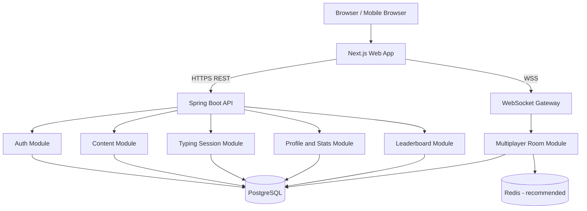

# TypeMaster — System Architecture

## 1. Architecture style
Use a modular monolith for the Spring Boot backend initially, with clear domain boundaries. This avoids premature microservices while keeping multiplayer and persistence separable later.

## 2. High-level architecture

## 3. Frontend modules
- `app/(public)`: landing, about, public leaderboard.
- `app/(game)`: typing test, practice and games.
- `app/(auth)`: login, register and password reset.
- `app/(app)`: dashboard, profile, history and settings.
- `app/admin`: content and moderation.
- `components/typing`: input engine, text renderer, timer and metrics.
- `lib/api`: typed API client and error mapping.
- `lib/realtime`: WebSocket client, reconnect and room event handlers.
- `lib/i18n`: locale dictionaries and locale routing.
- `features/*`: domain-specific UI and hooks.

Keep keystroke state local to the typing engine. Do not send each keystroke to the REST API.

## 4. Backend modules
Suggested packages:
- `auth`: registration, login, refresh, logout, password hashing and token lifecycle.
- `user`: profile, roles and preferences.
- `content`: passage catalog and admin content management.
- `typing`: session lifecycle, metrics and result persistence.
- `stats`: personal aggregates and history.
- `leaderboard`: ranking queries and anti-abuse eligibility.
- `multiplayer`: room lifecycle, participant state and WebSocket events.
- `moderation`: reports, sanctions and audit trail.
- `common`: errors, validation, security, observability and configuration.

Each module owns its service and repository boundary. Avoid controllers directly using JPA repositories.

## 5. Typing engine design
1. Fetch a passage and test configuration.
2. Initialize local state with target text, committed input, start timestamp and composition state.
3. Listen to input changes; do not count intermediate IME composition text.
4. Compare committed input with target using a documented Unicode policy.
5. Update local metrics on each committed change.
6. Stop at completion or timer expiry.
7. Submit final result to API if signed in; guest result remains local.
8. Server validates configuration, passage, timestamps and plausible limits before storing ranked-eligible result.

Use Unicode code points or grapheme clusters consistently for visual caret movement and character counts. JavaScript UTF-16 string indexes are not equivalent to user-perceived characters. Define and test normalization (NFC is a reasonable baseline) without silently changing the user's actual text.

## 6. Multiplayer architecture
- REST creates a room or returns a match ticket.
- WebSocket authenticates the member and joins an authorized room.
- Server owns room state and broadcasts countdown/start/progress/finish events.
- Client progress messages are rate-limited and contain only session/position telemetry, not claimed final score.
- Server verifies monotonic progress and finish conditions against the assigned passage.
- Persist final race and participant results transactionally.
- Redis stores ephemeral room coordination and pub/sub when multiple API instances are deployed. Single-instance development may use in-memory state but must not be mistaken for production-ready horizontal scaling.

Suggested events:
- Client → server: `room.join`, `room.ready`, `race.progress`, `room.leave`
- Server → client: `room.state`, `race.countdown`, `race.started`, `participant.progress`, `race.finished`, `room.error`

## 7. Authentication and security
- Use Spring Security.
- Passwords hashed using BCrypt or Argon2id.
- Prefer short-lived access token and rotating refresh token in HttpOnly, Secure, SameSite cookies; protect cookie-authenticated state-changing requests with CSRF controls.
- Store refresh token hashes, not raw refresh tokens.
- Apply authorization at service/API and WebSocket destination levels.
- Rate-limit login, registration, room creation, join attempts and progress messages.
- Validate origin for WebSocket handshake.
- Use DTOs, Bean Validation and parameterized queries.
- Add security headers and Content Security Policy.
- Never place secrets in `NEXT_PUBLIC_*` variables.

## 8. Deployment topology
### Frontend
- Deploy Next.js to Vercel or a Node hosting platform.
- Configure public API base URL and public WebSocket URL only.

### Backend
- Deploy Spring Boot container to AWS ECS/Fargate or App Runner.
- Use an Application Load Balancer with WebSocket support.
- Use managed PostgreSQL (RDS) with private networking.
- Use managed Redis (ElastiCache) when multi-instance rooms are enabled.
- Store secrets in AWS Secrets Manager / Parameter Store.
- Store logs and metrics in CloudWatch; configure alerts and backups.

### Environments
- local: Docker Compose for PostgreSQL and optional Redis.
- staging: production-like infrastructure with test accounts.
- production: TLS, backups, monitoring, WAF/rate limits and restricted database access.

## 9. Observability
- Structured JSON logs with trace ID and request ID.
- Metrics: request latency, 4xx/5xx, DB pool, WebSocket connections, room count, reconnect rate and race completion.
- Avoid logging typed passage input, passwords, tokens or personal data.
- Add health endpoints: liveness and readiness.
- Configure database backup restore drills.

## 10. Key architectural decisions
- Modular monolith before microservices.
- Guest-first practice; account optional.
- Local typing state; server persistence only at session completion.
- Server-authoritative multiplayer.
- English WPM and language-neutral CPM; Khmer word metric requires separate validation.
- Redis for production distributed room state.
